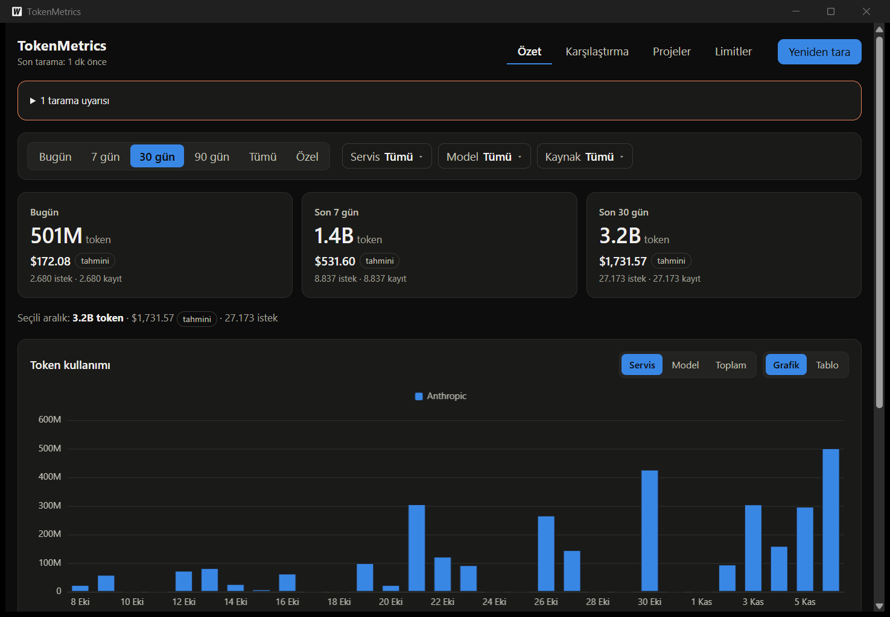

# TokenMetrics


A desktop app that tracks AI token usage and estimated cost from local logs and admin APIs.

[](https://github.com/muhammetsafak/TokenMetrics/actions/workflows/ci.yml)
[](LICENSE)
[](https://muhammetsafak.com/tan/)

TokenMetrics runs on Windows, macOS and Linux and shows where your AI tokens go.
It collects usage from the tools and accounts you already use, keeps it in a
local database and breaks it down by service, model, project, session and time.
The interface language is Turkish.



## Features

- Totals for today, the last 7 days and the last 30 days, and a token chart by
  hour or day, split by service or model.
- A model and service comparison table with input, output and cache tokens,
  request count and estimated cost.
- Usage per project and per session.
- Estimated subscription limit tracking for the 5-hour and weekly windows.
- Budget alerts as OS notifications and in the tray icon when a threshold you
  set is crossed.
- A system tray icon: closing the window keeps the app running and refreshing.
- JSON and CSV export and import, and manual entry for services that leave no
  logs.

Costs and limit percentages are **estimates**. Prices come from a built-in
static table that you can edit in Settings. Providers do not publish
subscription limits, so the limit values are approximate and labelled as such in
the interface.

## Quick Start

Build and run the app from source. You need Go (the version in `go.mod`),
Node.js 22 with npm, and the Wails CLI v2; on Linux also `libgtk-3-dev` and
`libwebkit2gtk-4.1-dev`.

```bash
go install github.com/wailsapp/wails/v2/cmd/wails@v2.17.1
git clone https://github.com/muhammetsafak/TokenMetrics.git
cd TokenMetrics
wails build
```

On Linux with webkit2gtk 4.1, run `wails build -tags webkit2_41` instead. The
binary is written to `build/bin/`. Start it, and the first scan reads the logs
of the supported tools that exist on your machine.

## Installation

Prebuilt archives for each platform are attached to every
[GitHub release](https://github.com/muhammetsafak/TokenMetrics/releases), together
with a `SHA256SUMS.txt` file. The binaries are not code signed and the macOS app
is not notarized, so each operating system asks for confirmation on the first
start.

| Platform | Archive |
|---|---|
| Windows | `tokenmetrics-<VERSION>-windows-amd64.zip` |
| macOS | `tokenmetrics-<VERSION>-macos-universal.zip` (Intel and Apple silicon) |
| Linux | `tokenmetrics-<VERSION>-linux-amd64.tar.gz` |

### Windows

Unzip and run `tokenmetrics.exe`. If SmartScreen warns about an unknown
publisher, choose **More info**, then **Run anyway**. The app needs the WebView2
runtime, which ships with current Windows 10 and Windows 11.

### macOS

Unzip, move `TokenMetrics.app` to `/Applications`, then right-click the app and
choose **Open** (then **Open** again in the dialog). A plain double-click is
blocked for unsigned apps. If macOS still refuses, remove the quarantine flag:

```bash
xattr -dr com.apple.quarantine /Applications/TokenMetrics.app
```

### Linux

```bash
tar -xzf tokenmetrics-<VERSION>-linux-amd64.tar.gz
./tokenmetrics
```

The app needs a desktop session and these runtime packages (Debian and Ubuntu
names):

- `libwebkit2gtk-4.1-0` and `libgtk-3-0` for the window.
- A Secret Service provider (GNOME Keyring, KDE Wallet with the Secret Service
  bridge, or KeePassXC) to store Admin API keys.
- A StatusNotifier host for the tray icon. KDE has one; on GNOME install the
  AppIndicator extension. Without it the tray icon is not shown and closing the
  window quits the app instead of hiding it.

`tokenmetrics --version` prints the version.

## Usage

### Data Sources

TokenMetrics reads these sources. Each one can be switched off, and the log
locations can be changed, in Settings.

| Source | Where it reads | Notes |
|---|---|---|
| Claude Code | `~/.claude/projects/**/*.jsonl` (or `$CLAUDE_CONFIG_DIR/projects`) | Local session logs. |
| Codex CLI | `~/.codex/sessions` (or `$CODEX_HOME/sessions`) | Local session files, including compressed `*.jsonl.zst` rollouts. |
| Gemini CLI | `~/.gemini/tmp` (or `$GEMINI_CLI_HOME/.gemini/tmp`) | Local chat recordings. |
| Anthropic Admin API | `api.anthropic.com` | API accounts only; needs an Admin API key. |
| OpenAI Admin API | `api.openai.com` | API accounts only; needs an Admin API key. |
| Manual entry and CSV import | Entered or imported in the app | For services that leave no logs. |

Scans are incremental: the app remembers how far it read each log file and only
reads what was appended. Rescanning never counts a message twice, and usage
already stored stays after the original log file is deleted. The
[design notes](docs/design.md) explain how records are identified.

### Exporting and Importing Data

You can export your data as JSON (a lossless copy, for example to move it to
another computer) or CSV, and import it again. The
[CSV and JSON formats](docs/csv-format.md) are documented separately.

### Privacy

- Usage data stays on your machine, in one SQLite file, `tokenmetrics.db`, in
  the app data directory. Set `TOKENMETRICS_DATA_DIR` to use another directory.

  | Platform | Data directory |
  |---|---|
  | Windows | `%AppData%\TokenMetrics` |
  | macOS | `~/Library/Application Support/TokenMetrics` |
  | Linux | `~/.config/TokenMetrics` (`$XDG_CONFIG_HOME/TokenMetrics`) |

- The log parsers read token counts and metadata (model, time, project
  directory, session ID), not your prompts or answers, and they never put log
  content in error messages.
- The only network traffic is the Admin API calls listed above, and only for
  providers you configured.
- Admin API keys are stored in the OS keychain (macOS Keychain, Windows
  Credential Manager, Linux Secret Service) under the service name
  `TokenMetrics`. The app never writes them to disk, to logs or to export files.

### Verifying the Claude Code Totals

`cmd/verify-claude` recomputes the Claude Code totals from the raw logs with its
own parser, which shares no code with the app's collector, and compares them
with the database model by model. It only reads `~/.claude`.

```bash
# Scan into a scratch database twice (the second scan must add nothing), then compare.
TOKENMETRICS_DATA_DIR=$(mktemp -d) go run ./cmd/verify-claude -scan
```

```bash
# Compare the database the app is using. Pass -claude-dir if you changed the
# Claude log location in Settings.
go run ./cmd/verify-claude
```

It prints raw, app and difference rows per model and exits with status 1 when
anything differs. When log files the app had read are gone, it reports
`INCONCLUSIVE` and exits with status 2 instead of reporting a mismatch; use the
`-scan` form for a like-for-like check. `cmd/verify-codex` does the same for
Codex CLI.

## Documentation

- [CSV and JSON data formats](docs/csv-format.md)
- [Design notes](docs/design.md)

## Project Status

**Beta.** The app is feature complete for its first release and versioned as
`0.y.z`, so breaking changes can still happen between minor versions.

## Contributing

Contributions are welcome. Read the [contributing guide](CONTRIBUTING.md) before
opening an issue or pull request.

## Security

Do not report security vulnerabilities through public issues; follow the
[security policy](SECURITY.md) instead.

## License

Licensed under the [GNU General Public License v3.0 only](LICENSE) (`GPL-3.0-only`).
